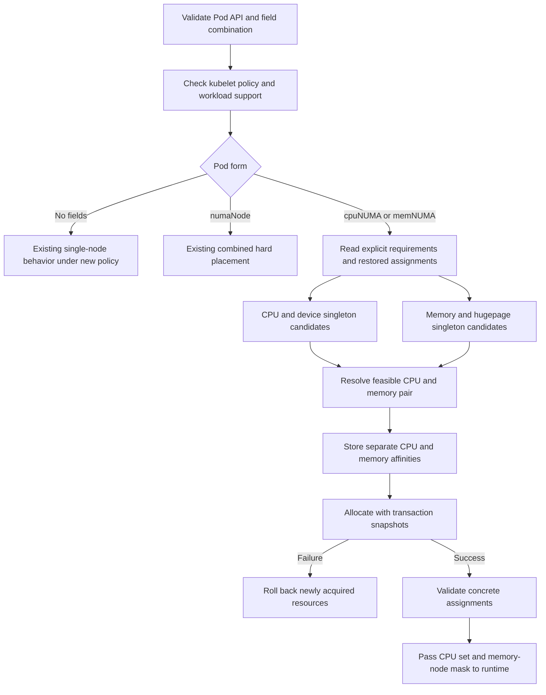

# Implementation plan

Status: design approved on 2026-10-14; no implementation performed.

Execution follows the approved 11-ticket breakdown in [the tracker map](map.md#published-tickets).
The eight work slices below are the earlier architectural outline, not the
current ticket numbering or dependency order.

Contract: [spec.md](spec.md). Decisions: [map.md](map.md).
Acceptance: [validation-plan.md](validation-plan.md).

## Allocation flow

## Code entry points

Paths are relative to the Kubernetes repository. Baseline inspected: `621a7c5c03e`.

| Concern | Main source locations |
| --- | --- |
| Pod API | `staging/src/k8s.io/api/core/v1/types.go`, `pkg/apis/core/types.go` |
| API validation/lifecycle restrictions | `pkg/apis/core/validation/validation.go`, `pkg/kubelet/allocation/handlers.go` |
| Policy name/configuration | `pkg/kubelet/apis/config/types.go`, `staging/src/k8s.io/kubelet/config/v1beta1/types.go`, `pkg/kubelet/apis/config/validation/validation.go`, `cmd/kubelet/app/options/options.go` |
| Local support/topology checks | `pkg/kubelet/numa_placement.go` |
| Policy registration and planning | `pkg/kubelet/cm/topologymanager/topology_manager.go`, `policy.go`, `scope_pod.go`, proposed `policy_independent_numa.go` |
| Topology and distances | `pkg/kubelet/cm/topologymanager/numa_info.go`; cAdvisor discovery already retains CPU-less nodes |
| Affinity storage and cleanup | `pkg/kubelet/cm/topologymanager/scope.go`, store interfaces, `pkg/kubelet/cm/container_manager_linux.go` |
| CPU allocation/options/recovery | `pkg/kubelet/cm/cpumanager/policy_static.go`, `cpu_manager.go`, `policy_options.go` |
| Memory allocation/rollback/recovery | `pkg/kubelet/cm/memorymanager/policy_static.go`, `memory_manager.go` |
| Devices | `pkg/kubelet/cm/devicemanager/topology_hints.go`, `manager.go`; preserve existing behavior |
| Runtime enforcement | `pkg/kubelet/cm/internal_container_lifecycle_linux.go` |
| Runtime tooling baseline | `.scratch/explicit-numa-placement/runtime/` |

## Work slices

Every intermediate slice must build and fail closed for requests whose
enforcement is incomplete. Do not accept new-field Pods on the strength of API
validation or policy registration alone. Use focused tests per slice, then one
integrated regression run after the complete enforcement path is enabled.

### 01 — API and request classification

Add optional fields, a single internal resolver for ordinary/legacy/independent
requests, field-combination/range/eligibility/immutability validation, resize
and ephemeral restrictions, and serialization/conversion tests. Keep new-field
admission explicitly unsupported until later slices connect enforcement.
Use repository generators, including `make update` as required by AGENTS.md;
do not hand-edit generated files or modify module files manually. Review and
explain generated changes instead of discarding unrelated user changes.

Done when all API paths preserve nil versus zero, reject mixed forms and invalid
updates, and legacy/no-field validation behavior is preserved.

### 02 — New policy and placement planner

Depends on 01. Register `independent-numa`, validate Linux/pod scope, update help
and policy documentation, and retain existing defaults. Extend incompatible CPU
option validation. Implement separate group planning, fixed-target filtering,
CPU-to-memory ranking, tie-breaking, and strict distance-data failure semantics.
Test CPU-less and sparse topology without requiring hardware. Keep no-field and
legacy policy delegation under test. Preserve resource-count and policy options.

Done when planner tests establish exact pairs or specific refusal reasons,
including device conflicts and insufficient capacity on a singleton.

### 03 — Allocation, affinity storage, and transaction cleanup

Depends on 02. Introduce resource-specific memory affinity storage/view, connect
the independent plan to CPU/Memory Managers, and enforce resolved nodes whether
specified or automatic. Generalize rollback to the relevant allocations and
reuse state on every affected node. Carry separate masks to Linux runtime.
Test failures injected after each allocator/container boundary and verify
pre-existing allocations remain intact.

Done when successful allocations match the plan and every injected partial
failure releases only the newly acquired resources.

### 04 — Restart, compatibility, and observability

Depends on 03. Validate/reconstruct plans from checkpoints, preserve automatic
targets, and reject conflicting or inconsistent restored assignments. Exercise
partial restoration, app/init/sidecar reuse, unsupported operations, cleanup of
both stored hints, and device state preservation. Report CPU and memory failures
separately. Fix common-alignment metrics/logging for actual common versus split
placement. Complete no-field and legacy compatibility before enabling admission.

Done when new-field admission is enabled only with the complete enforcement and
recovery path, and the policy/Pod-form matrix passes regression tests.

### 05 — Integrated automated checks

Depends on 04. Exercise admission through concrete allocation, restart validation,
failure cleanup, and Linux pre-create masks with synthetic topology. Run focused
API, config, CPU, memory, topology, device, allocation, and lifecycle package
tests appropriate to touched code. Build the Linux-targeted code if developing
on macOS; a cross-build is not a runtime test. Run relevant repository verification
and generator checks, documenting environmental failures rather than counting
them as passes. Avoid a repository-wide test run until a concrete need justifies it.

Done when the automated acceptance matrix is covered with recorded commands,
results, commit, and explicit limitations.

### 06 — Manual runtime validation kit

Can develop after 02; finalize after 04. Add independent expected CPU/memory nodes
to mask checking and fixtures for explicit, partial, legacy, and no-field forms.
Add memory-only-node setup guidance, recovery/failure scenarios, and a dated
results template. Preserve old fixtures or their legacy CLI compatibility.
Include commands for observing actual touched-page placement. Guide users to
provision required static-manager reservations per actual topology, without
assuming every memory node has CPUs.

Done when the user can run the documented matrix manually on a Linux VM or host
and record PASS/FAIL/NOT RUN for each case. Running it is milestone 2.

### 07 — STREAM workload and experiment kit

Depends on 06 for evidence capture. Package a pinned official STREAM source
revision/checksum and reproducible compiler/build flags in a container image.
Provide configurable array size, threads, resource limits, and CPU/memory IDs.
Add paired DDR/HBM or virtual-node manifests and a runner that records metadata,
raw output, actual CPU sets, memory residency, and repeated-run summaries.
If residency capture requires a controlled pause, document that harness change
and keep it outside timed STREAM kernels. Keep upstream numerical validation.

Done when tooling is runnable and its result parser/metadata path is checked
without inventing throughput results. Hardware-dependent rows remain NOT RUN
until executed. This completes the software/tooling milestone with slices 01–06.

### 08 — User-operated runtime evidence

Depends on milestone 1 and chosen environment. Run the runtime matrix in the
user's VM or on team-provided hardware. Record the guest/host topology boundary.
Run paired STREAM experiments where capacity permits. Label VM results as VM
measurements; claim DDR/HBM comparisons only when actual memory types and mapping
are verified. Investigate failures before claiming acceptance. No performance
speedup threshold applies.

## Risks that affect implementation

- One shared affinity cannot represent the pair. Avoid unions that permit CPU
  spreading or memory-mask expansion.
- A request with an omitted field still needs a resolved target, rollback, and
  checkpoint consistency for that resource.
- Available capacity must retain init/sidecar lifetime semantics; summing every
  container simultaneously is incorrect.
- CPU topology alone cannot validate memory-only node IDs.
- NUMA distance row mapping must match the source; synthetic sparse IDs must not
  hide out-of-bounds indexing or ambiguous decoding.
- Existing restored assignments constrain automatic placement before locality
  optimization. Better currently available locality is not grounds to relocate.
- A new policy name requires audits of policy-name conditionals, CPU options,
  metrics, configuration validation, help text, and default behavior.
- Successful mask enforcement alone is insufficient evidence of STREAM-array
  page residency. The benchmark needs observations of its live initialized arrays.

No Kubernetes source code, generated artifacts, runtime configuration, or
deployment has been changed during planning.
